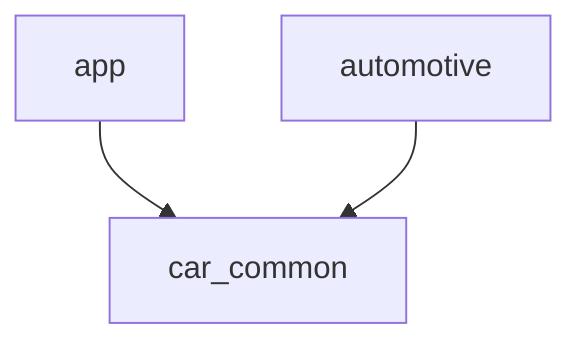

MapLibre Sample app for Android Auto and Automotive
===================================================

This sample app will demonstrate how to use MapLibre on Android Auto and Android Automotive.
(Also known as AAOS, Android for Cars)


So how does this work?
----------------------
Android Auto uses a Template system. It will not allow you to use regular views.
MapLibre will provide the map as a View. If we want to use this MapView on Android Auto, we have to render it on the provided Surface.
See also: https://developer.android.com/training/cars/apps#declare-surface-permission

To get the MapView to render on the surface, we do the following;
We render the MapView offscreen, create a 'screenshot' of this view. 
And we'll draw this Bitmap to the Surface via a Canvas.
Repeat the process 30 times per second, and you've got a working MapView on Android Auto.

This process is not very efficient, but this is what we got to work with.
Maybe in the future, we can find a solution to make MapLibre draw directly unto the Surface,
and thereby skip the workaround. Which is drawing a Bitmap on a Canvas.


How is the code structured?
---------------------------
The map can be drawn on Android Auto, and Android Automotive. A lot of code (most of it), can be shared between the two.
Therefore, this bulk of the code is in a shared module, called `car_common`. This is used by the `app` (Smartphone app, uses Android Auto) and the `automotive` module.
The `automotive` module contains little code of its own, just some config and resources. Everything the car app uses comes from the `car_common` module; the only exceptions are the plain activities that render a map outside of the car app templates.




Enough words; Show me the code!
-------------------------------

We have a class called `CarMapContainer`, which will take care of the MapView code;  
This is to create the MapView, enable texture mode, and add to the WindowManager. 
This is needed to ensure the MapView will render, and we can get the Texture later for rendering it onto the Canvas.
```kotlin
val mapView = MapView(carContext, MapLibreMapOptions.createFromAttributes(carContext).apply {
    // Set the textureMode to true, so a TextureView is created
    // We can extract this TextureView to draw on the Android Auto surface
    textureMode(true)
}).apply {
    setLayerType(View.LAYER_TYPE_HARDWARE, Paint())
}
//(...)
carContext.windowManager.addView(
    mapView /* the MapView */,
    getWindowManagerLayoutParams()
)
```

Furthermore, we have a class called `CarMapRenderer`, which will render the Map on the provided Surface.
```kotlin
//Make sure to get the Surface by registering as SurfaceCallback
override fun onCreate(owner: LifecycleOwner) {
    super.onCreate(owner)
    try {
        carContext.appManager.setSurfaceCallback(this) //Make sure we get the Surface from Android Auto
    } catch (e: Exception) {
        Log.e(LOG_TAG, "Could not set surface callback", e)
        return
    }
}

//In onSurfaceAvailable, we get the Surface onto which we need to draw the map

    override fun onSurfaceAvailable(surfaceContainer: SurfaceContainer) {
        Log.v(LOG_TAG, "CarMapRenderer.onSurfaceAvailable")
        this.surfaceContainer = surfaceContainer
        mapContainer.setSurfaceSize(surfaceContainer.width, surfaceContainer.height)

        // // Start rendering the map on the Android Auto surface when any behavior changes are detected in the map.
        mapContainer.mapViewInstance?.apply {
            addOnDidBecomeIdleListener { drawOnSurface() }
            addOnWillStartRenderingFrameListener {
                drawOnSurface()
            }
        }
        runOnMainThread {
            // Start drawing the map on the android auto surface
            drawOnSurface()
        }
    }

//Using a canvas, draw the map
private fun drawOnSurface() {
    val mapView = mapContainer.mapViewInstance ?: return
    val surface = surfaceContainer?.surface ?: return
    val canvas = surface.lockHardwareCanvas()
    drawMapOnCanvas(mapView, canvas)
    surface.unlockCanvasAndPost(canvas)
}

//The actual drawing of the map
private fun drawMapOnCanvas(mapView: MapView, canvas: Canvas) {
    val mapViewTextureView = mapView.takeIf { it.childCount > 0 }?.getChildAt(0) as? TextureView
    mapViewTextureView?.bitmap?.let {
        canvas.drawBitmap(it, 0f, 0f, null)
    }
}

```

Other MapTiles / Style
----------------------

You can fix this by setting your own Style.
Set this in the following places:

Set your own Style in: `CarMapContainer.kt` (car_common);
```kotlin
getMapAsync {
    mapViewInstance = this
    mapLibreMapInstance = it
    it.setStyle(
        //TODO: Set your own style here
        Style.Builder().fromUri("https://demotiles.maplibre.org/style.json")
    )
}
```
And in `MainActivity` (app);
```kotlin
private fun initMap(map: MapLibreMap) {
    try {
        map.setStyle(
            //TODO: Set your own style here!
            Style.Builder().fromUri("https://demotiles.maplibre.org/style.json")
        )
    } catch (e: Exception) {
        Log.e("MapLibreCar", "Error setting local style", e)
    }
}
```

Rendering outside of the car app templates
------------------------------------------
The car app templates cannot reach every display of a car. On Android Automotive,
apps render on the instrument cluster by launching a plain activity on that
display. The `automotive` module ships two activities that render a `MapView`
directly, next to the regular car app:

- `FullscreenMapActivity`: a fullscreen map with zoom and recenter controls.
- `ClusterMapActivity`: a lean map for the cluster, with a tilted camera
  tracking the vehicle.

They share `BaseMapActivity`, which also feeds the location puck from the raw
`LocationManager` instead of the default location engine, so it works on
emulators that do not ship one.

Both activities have no intent filter; start them by component name, optionally
targeting a display. On Android Automotive the foreground user is a secondary
user, so pass `--user current` or the app launches for the wrong user and never
appears:

```bash
# FullscreenMapActivity on the main display
adb shell am start --user current \
    -n nl.flitsmeister.maplibrecar.automotive/.FullscreenMapActivity

# ClusterMapActivity on the instrument cluster (display 2 here; list displays
# with `adb shell dumpsys display | grep mDisplayId`)
adb shell am start --user current --display 2 \
    -n nl.flitsmeister.maplibrecar.automotive/.ClusterMapActivity
```

From code, use `ActivityOptions.makeBasic().setLaunchDisplayId(displayId)` to
launch on a specific display.

Main MapLibre website
---------------------
https://maplibre.org/

Discussing
----------
This project can be discussed on the OSM-US Slack, in channel #maplibre-android, invite link: https://slack.openstreetmap.us/

Contributing
------------
We welcome contributions to this project. Please read the [Contributing Guidelines](CONTRIBUTING.md) for more information.

License
-------
[MIT](LICENSE)

Contributor
--------
[Flitsmeister](https://flitsmeister.nl)

[MapLibre](https://maplibre.org)

<a href="https://maps.vietmap.vn">

</a>

Copyright (c) 2025 MapLibre contributors
